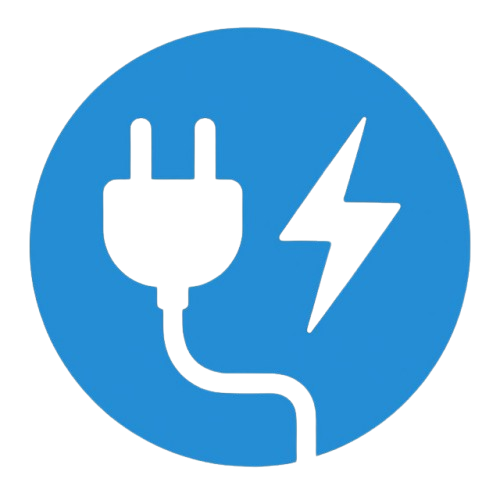

<div align="center">
  

# Svitlo Kremen Bot

A Telegram bot for tracking power outage schedules in Kremenchuk.
Reads schedules straight from [poe.pl.ua](https://www.poe.pl.ua/) — the provider that publishes them — and sends a clean text schedule to subscribers.

**[@svitlo_kremen_bot](https://t.me/svitlo_kremen_bot)**

</div>

## Features

### Straight from the provider
The bot polls the same endpoint the provider's own page calls to draw its grid and broadcasts a schedule as soon as it is published. Nobody has to repost a screenshot first.

How closely it watches follows the data: every 5 minutes while grids are being published, every 30 when the provider keeps answering "nothing planned", and always every 5 during the evening window when tomorrow's grid appears. A quiet month costs a fiftieth of the requests and the first grid of a season is still caught within minutes.

"Станом на …" is the provider's own last-updated stamp, so it is the moment the schedule actually appeared or changed. That matters most for schedules published the evening before — a stamp of `09.04.2026 20:11` on a schedule for the 10th is something a reposter's message time could never tell you.

Changes are detected by comparing the grid itself, not the stamp. A restamped but identical schedule wakes nobody; changed cells notify even if the stamp stands still.

A Telegram channel stays wired up as a fallback, recognising a posted schedule screenshot via OCR — but only once poe.pl.ua is actually down: unreachable for several polls in a row, its markup no longer parsing at all, or the direct source turned off outright. The channel's own authors watch and parse the same page independently of the bot, and can misread it or amend it later, so it never gets to race the direct source for whichever answers first. An admin can still force a specific photo through at any time, bypassing the check — that is a deliberate instruction, not the automatic fallback. Either source can be turned off — see [Configuration](#configuration).

### The provider's table, as a picture
Every schedule arrives as the grid subscribers are used to seeing on the site — all six queues, half-hour cells, the "обсяг черг" preamble and the provider's timestamp — with the text below it as the photo's caption, so it is one message rather than two. A schedule too long for Telegram's 1024-character caption follows as its own message instead.

It is drawn with Pillow, not captured from the page: no headless browser in the image, and it works for schedules recognised from a screenshot too. Colours, geometry and type were measured off real screenshots of the site, so it reads as one rather than as a chart of our own.

Every cell is coloured as the provider coloured it. The published ranges merge the off and switching halves into one interval, so a picture rebuilt from them alone has to guess where the yellow sits — and guesses wrong whenever a block crosses midnight. The provider's own cells are parsed alongside the ranges and used verbatim, which makes the grid match the site cell for cell. Schedules recognised from a screenshot carry no cells, and fall back to the reconstruction.

If it cannot be drawn — missing fonts, anything unexpected — the schedule still goes out as text. Quiet days and cancellations carry no picture: there is no grid to draw.

A rendered picture is cached, keyed by what it contains, and uploaded once per broadcast: Telegram files the photo under an id, and the rest of the subscribers are sent that id rather than 50KB each.

### Personal notifications by queue
Each subscriber selects their sub-queue (e.g. `3.2`). The bot sends only the information relevant to that queue — with a progress bar and total hours without power.

### Change tracking
When a published schedule is amended, the bot shows the current picture *and* what moved, so a subscriber who opens the chat hours later does not have to reconstruct anything. Only the ongoing and upcoming ranges are printed — an outage that already finished by the time the update went out is not repeated, and the hour totals and bar count against what is left of the day, not all 24 hours of it. Telegram's HTML has no text colour, so a lengthened or shortened interval is marked with 🔴/🟢 instead:

```
🔄 Оновлення графіку на 10.04.2026 (станом на 08:30)

🟡 1 черга
  1.2 · 07:30–10:00, 13:30–16:00, 19:30–20:30

🟥🟥🟥🟥🟥🟩🟩🟩🟩🟩🟩🟩

🕯️ 6.0 год без світла
💡 9.5 год зі світлом

📋 Зміни:
⏰ Черга 1.2: розширили (було 13:30–15:30 → стало 🔴13:30–16:00)

⏱ Вимикають упродовж 30 хв після початку, вмикають в останні 30 хв інтервалу.
```

(1.2's day started with 00:30–03:00 too, but that was already over by 08:30 and is left out.)

An amendment only reaches subscribers whose own queue moved. A first publication and a cancellation reach everyone:

```
✅ Графік на 11.04.2026 скасовано — відключень не прогнозується.
За даними Полтаваобленерго станом на 10.04.2026 23:15.
```

### Quiet days are an answer, not a silence
The provider publishes today and, from the evening, tomorrow. When it announces that no outages are expected, that is a fact worth stating plainly — and different from having heard nothing at all:

```
🟢 На завтра (11.04.2026) відключень не прогнозується.
За даними Полтаваобленерго станом на 10.04.2026 20:30.
```

Quiet days are recorded but not broadcast — otherwise every calm day would wake every subscriber.

### What's the status right now?
The bot answers in real time (with a themed picture): is there power or not, how long until the next outage or restoration.

```
💡 Зараз є світло · черга 3.2
до 14:30 (ще 1 год 20 хв)
Далі: відключення 14:30 – 16:00
```

During an outage it also says when power may come back early, because the last half hour of any range is a switching window:

```
🔴 Зараз відключення · черга 1.2
до 15:00 (ще 1 год 20 хв)
💡 Світло може з'явитись раніше — з 14:30
Далі: світло з 15:00 до 19:30
```

### Find your queue by address
Don't know your queue? The bot resolves it from your address: pick a city or type your village, then type your street — search is typo-tolerant. If a street is split between queues, the bot shows each queue's house numbers so you pick your own. One more tap subscribes you to notifications for that queue.

```
🔍 Яка у мене черга?
📍 м. Кременчук  →  вул. Лесі Українки
🟤 Ваша черга: 5.2
[✅ Отримувати сповіщення для 5.2]
```

Covers the whole Kremenchuk branch: Kremenchuk, Horishni Plavni, Kobeliaky, Hlobyne and ~200 villages (many resolve instantly — the entire settlement is in one queue).

### The admin hears who comes and goes
Both directions reach the admin through the bot itself — a count that only ever rises says nothing, and people leaving right after a particular broadcast is the one signal worth having:

```
🎉 Новий підписник            👋 Відписався
Іван Коваль (@ivan) · id 1    Олена · id 2
Черга: 3.2                    Черга: 1.1
Всього: 42                    Всього: 41
```

Every way in is covered, including the address wizard, which subscribes people as a side effect of picking their queue. Only a chat that genuinely entered or left the list is announced, so a repeated `/subscribe` is silent — and the notice is sent after the person has already been answered, so failing to deliver it costs the admin a message and them nothing.

### Statistics
View outage hours for the last 7 or 30 days for your queue.

```
📊 Статистика за 7 днів — черга 3.2

10.04.2026  🟥🟥🟥🟩🟩🟩🟩🟩🟩🟩🟩🟩  6.0 год
09.04.2026  🟥🟥🟩🟩🟩🟩🟩🟩🟩🟩🟩🟩  4.0 год

Середнє: 5.0 год/день
```

## Schedule format

Full schedule (no queue filter):

```
⚡ Графік відключень на 10.04.2026 (станом на 09.04.2026 20:11)

🟡 1 черга
  1.1 · 00:00–02:30, 07:00–09:30, 13:00–15:00, 19:00–20:30
  1.2 · 00:30–03:00, 07:30–10:00, 13:30–15:30, 19:30–20:30
🟢 2 черга
  2.1 · 02:00–03:30, 08:00–10:30, 14:00–16:00, 20:00–21:00
  2.2 · 02:30–04:00, 08:30–10:30, 14:30–16:30, 20:30–21:30
...
🟣 6 черга
  6.1 · 00:00–00:30, 06:00–08:30, 12:00–14:00, 18:00–19:30
  6.2 · 00:00–01:00, 06:30–09:00, 12:30–14:30, 18:30–20:00

⏱ Вимикають упродовж 30 хв після початку, вмикають в останні 30 хв інтервалу.
```

Personal schedule (queue selected) adds a day summary:

```
🟡 1 черга
  1.2 · 00:30–03:00, 07:30–10:00, 13:30–15:30, 19:30–20:30

🟥🟥🟥🟥🟩🟩🟩🟩🟩🟩🟩🟩

🕯️ 8.0 год без світла
💡 16.0 год зі світлом
```

### Why the ranges have soft edges

The provider's grid is half-hour cells in three colours: on, off, and a switching window it labels *"Час, необхідний для перемикань. Електроенергії може не бути"*. Its own rules say the cut happens within 30 minutes of the queue's start time and power returns during the last 30 minutes of the block.

So a published range spans its switching halves, and both edges are soft by the same half hour. The bot merges the switching cells into the range — producing the same times the provider publishes in text — and states the caveat once at the foot of a message rather than beside each of the ~48 ranges a full schedule prints.

## Configuration

Copy `.env.example` to `.env`. Beyond the Telegram credentials:

| Variable | Default | Meaning |
| --- | --- | --- |
| `POE_SOURCE_ENABLED` | `1` | Poll poe.pl.ua — the primary source |
| `POE_POLL_INTERVAL` | `300` | Seconds between polls while schedules are running |
| `POE_QUIET_INTERVAL` | `1800` | Seconds between polls while nothing is planned |
| `POE_PROXY` | — | Proxy for provider requests only; needed where the provider blocks the host |
| `TELEGRAM_SOURCE_ENABLED` | `1` | Keep the screenshot-OCR fallback running |

The Dockerfile installs everything the bot needs. Running it outside Docker also needs **fonts-liberation** (the schedule picture is set in Liberation Sans) and **tesseract-ocr-ukr** for the screenshot fallback; without the fonts the bot still works, it just sends schedules as text.

```
pip install -r requirements-dev.txt   # runtime deps plus pytest
python -m pytest tests/
```

## Tech stack

- Python 3.12
- httpx (poe.pl.ua polling — the primary source)
- Pillow + fonts-liberation (draws the schedule picture)
- OpenCV + Tesseract OCR (screenshot fallback)
- Telethon (channel monitoring for the fallback)
- Telegram Bot API
